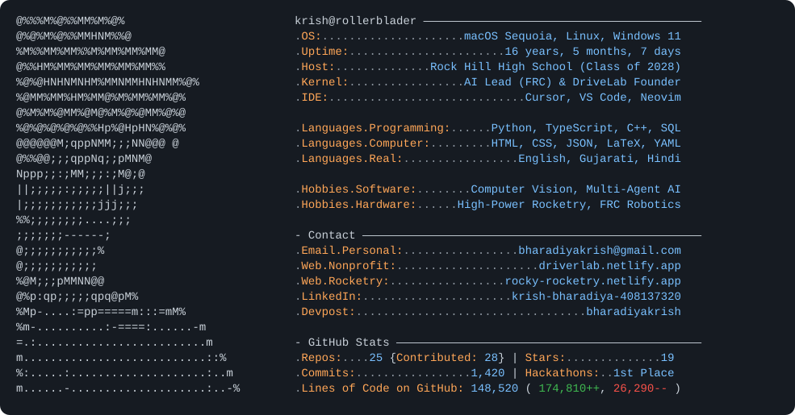

<picture>
  <source media="(prefers-color-scheme: dark)" srcset="https://raw.githubusercontent.com/TheRollerBlader/TheRollerBlader/main/dark_mode.svg">
  <source media="(prefers-color-scheme: light)" srcset="https://raw.githubusercontent.com/TheRollerBlader/TheRollerBlader/main/light_mode.svg">
  
</picture>

<details>
<summary>Plaintext / Markdown Terminal Block (if not using SVG files)</summary>

```text
          @%%%M%@%%MM%M%@%            krish@rollerblader —————————————————————————————————————————
         @%@%M%@%%MMHNM%%@            . OS: ..................... macOS Sequoia, Linux, Windows 11
       %M%%MM%MM%%M%MM%MM%MM@         . Uptime: ....................... 16 years, 5 months, 7 days
       @%%HM%MM%MM%MM%MM%MM%%         . Host: .............. Rock Hill High School (Class of 2028)
     %@%@HNHNMNHM%MMNMMHNHNMM%@%      . Kernel: ................. AI Lead (FRC) & DriveLab Founder
      %@MM%MM%HM%MM@%M%MM%MM%@%       . IDE: ............................. Cursor, VS Code, Neovim
      @%M%M%@MM%@M@%M%@%@MM%@%@
      %@%@%@%@%@%%Hp%@HpHN%@%@%       . Languages.Programming: ...... Python, TypeScript, C++, SQL
       @@@@@@M;qppNMM;;;NN@@@ @       . Languages.Computer: ......... HTML, CSS, JSON, LaTeX, YAML
        @%%@@;;;qppNq;;pMNM@          . Languages.Real: ................. English, Gujarati, Hindi
        Nppp;;:;MM;;;:;M@;@
        ||;;;;;:;;;;;||j;;;           . Hobbies.Software: ........ Computer Vision, Multi-Agent AI
         |;;;;;;;;;;;jjj;;;           . Hobbies.Hardware: ...... High-Power Rocketry, FRC Robotics
          %%;;;;;;;;....;;;
            ;;;;;;;------;            - Contact ——————————————————————————————————————————————————
            @;;;;;;;;;;;%             . Email.Personal: ................. bharadiyakrish@gmail.com
            @;;;;;;;;;;;              . Web.Nonprofit: ..................... driverlab.netlify.app
          %@M;;;pMMNN@@               . Web.Rocketry: ................. rocky-rocketry.netlify.app
       @%p:qp;;;;;qpq@pM%             . LinkedIn: ...................... krish-bharadiya-408137320
    %Mp-....:=pp=====m:::=mM%         . Devpost: .................................. bharadiyakrish
  %m-..........:-====:......-m
  =.:.........................m       - GitHub Stats —————————————————————————————————————————————
 m...........................::%      . Repos: .... 25 {Contributed: 28} | Stars: .............. 19
%:.....:....................:..m      . Commits: ................. 1,420 | Hackathons: .. 1st Place
m......-....................:..-%     . Lines of Code on GitHub: 148,520 ( 174,810++,   26,290-- )
```

</details>

### Selected Systems & Research

| Project | Architecture & Technical Scope | Recognition / Status |
| :--- | :--- | :--- |
| **[SignBridge](https://github.com/TheRollerBlader/SignBridge)** | Real-time browser ASL-to-English translator. Extracts 21 3D hand landmarks per frame via MediaPipe, runs exponential moving-average temporal smoothing and PyTorch classification over WebSockets, and synthesizes speech with the Gemini API (~300 ms latency). | **1st Place**, Raven Hacks VTL · [Devpost](https://devpost.com/software/project-signbridge) · [Live App](https://projectsignbridge.netlify.app) |
| **[frc-vision-scout](https://github.com/TheRollerBlader/frc-vision-scout)** & **[auto_scout](https://github.com/Prosper-FRC/auto_scout)** | Match video telemetry pipeline for FIRST Robotics Competition. Pairs YOLO11 detection with ByteTrack multi-object tracking and a 4-point planar homography solver to project broadcast footage onto 2D field coordinates and log robot cycle times. | Active deployment for [MercsMavs-MSA](https://github.com/MercsMavs-MSA) & [Prosper-FRC](https://github.com/Prosper-FRC) |
| **[st-pc-uq-gkan](https://github.com/TheRollerBlader/st-pc-uq-gkan)** | Spatiotemporal Physics-Constrained Graph Kolmogorov-Arnold Network forecasting geomagnetic storms and Geomagnetically Induced Currents (GIC) from NOAA SWPC ($L_1$ Lagrange point) and SuperMAG magnetometer feeds with conformal prediction bounds. | **Published Abstract**, AGU Bright Stars (Aug 2026) |
| **Synthetic Sentinels** | Hierarchical multi-agent pipeline (YOLO perception + XGBoost trajectory classification) for automated near-Earth asteroid verification. Cut human analyst latency by 71% across Unity orbital physics simulations and Monte Carlo trajectory sweeps. | **2nd Place Internationally**, ISRC · **3rd Place NSS Award**, DRSEF |
| **[rocky](https://github.com/TheRollerBlader/rocky)** | 6-DOF flight dynamics simulator and telemetry web application for the American Rocketry Challenge, implementing 4th-order Runge-Kutta (RK4) numerical integration and `.eng`/`.rse` thrust curve parsing. | [Live Telemetry App](https://rocky-rocketry.netlify.app) |
| **[flood-alert](https://github.com/TheRollerBlader/flood-alert)** | North Texas hydrological warning monitor tracking USGS stream gauges and precipitation feeds across Prosper, Frisco, and McKinney to model low-water crossing road hazards. | Congressional App Challenge (TX-04) |

### Additional Repositories

* **Quantitative & ML Systems**: [`crypto-trading-llm`](https://github.com/TheRollerBlader/crypto-trading-llm) (LLM market sentiment extraction & backtesting) · [`crypto-stock-candlestick-tracker`](https://github.com/TheRollerBlader/crypto-stock-candlestick-tracker) (real-time market candlestick & technical indicator tracker)
* **WebGL & Data Visualization**: [`github-contribution-galaxy`](https://github.com/TheRollerBlader/github-contribution-galaxy) (3D WebGL procedural commit galaxy) · [`spotify-listening-dashboard`](https://github.com/TheRollerBlader/spotify-listening-dashboard) (D3.js & TypeScript streaming analytics) · [`personal-finance-sankey`](https://github.com/TheRollerBlader/personal-finance-sankey) (cash-flow waterfall & Sankey diagram builder) · [`wikipedia-link-explorer`](https://github.com/TheRollerBlader/wikipedia-link-explorer) (hyperbolic knowledge graph & shortest-path explorer)
* **Geophysical & Algorithmic Engines**: [`global-earthquake-live-map`](https://github.com/TheRollerBlader/global-earthquake-live-map) (seismic & tectonic plate visualizer) · [`weather-pattern-explorer`](https://github.com/TheRollerBlader/weather-pattern-explorer) (isobaric jet stream explorer) · [`sorting-pathfinding-visualizer`](https://github.com/TheRollerBlader/sorting-pathfinding-visualizer) (graph traversal & sorting visualizer)
* **Developer Tooling & Media**: [`motion-graphic-style-library`](https://github.com/TheRollerBlader/motion-graphic-style-library) (Remotion kinetic typography primitives) · [`code-repository-analyzer`](https://github.com/TheRollerBlader/code-repository-analyzer) (static dependency & topology inspector) · [`scouting-hosting`](https://github.com/TheRollerBlader/scouting-hosting) (FRC scouting web service)

### Leadership & Engineering Programs

* **[DriveLab](https://driverlab.netlify.app)** — *Founder*. Volunteer-led engineering nonprofit (501(c)(3) pending) in Prosper, TX teaching grades 6–8 mechanical and electrical fundamentals through an 8-session RC car build curriculum and district race day.
* **Mercs Robotics ([MercsMavs-MSA](https://github.com/MercsMavs-MSA)) & [Prosper Engineering](https://github.com/Prosper-FRC)** — *AI Lead*. Leading computer vision and autonomous scouting software for competitive FIRST Robotics Competition teams.
* **[Rock Hill ARC Rocketry](https://rocky-rocketry.netlify.app/#team)** — *Founder & Lead Designer*. Established Rock Hill High School's 9-member American Rocketry Challenge team; leads airframe CAD, stability modeling, and flight simulation.
